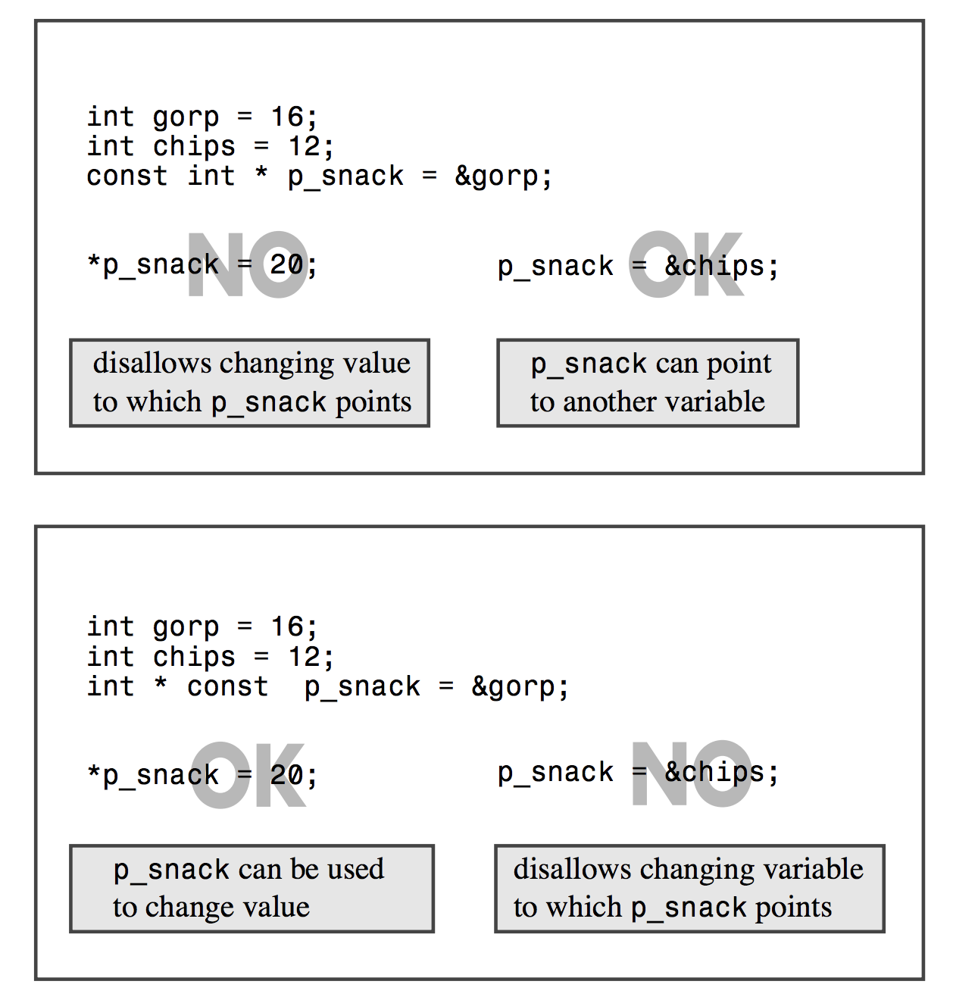

Using ***const*** key word with a pointer has subtle aspects and it is worth talking about it.


# *Point-to-const* or *const pointer*

You can use the ***const*** keyword in two different ways with pointers.

> The first way is to make a pointer point to a constant object, and that prevents you from using the pointer to change the pointed-to value. 

> The second way is to make the pointer itself constant, and that prevents you from changing where the pointer points.

This words are subtle and confusing the first time I read them especially after I read some examples about assignment and changeability. However, once I know the purpose of using ***const*** key word, things become crystal clear. 

So, why are we using ***const*** to pointer? The answer is simple: we want to protect the data. Specifically, the data could be value or address. So when you use the ***const*** key word, you should ask yourself the question first, which one would you want to protect, the value or the address?

If you want to protect the value, you should make a pointer point to a constant object. You tell the compiler, this pointer point to some value that you'd better not make a change. It means even you have the pointer, you can not change the value through pointer,  because the value is now protected.

If you want to protect the address, you should make the pointer itself constant. You tell the compiler this pointer is binding to some address and you'd better not change it. It is more like binding the relationship between the pointer and the value it point to.


# Examples

## pointer to constant

* Example 1

> assigning the address of a const variable to a pointer-to-const.

```c++
const float value = 9.80;
const float * ptr = &value;
```

you can use neither value nor ptr to change the value 9.80. You can not do the following things

```c++
*ptr += 1; //invalid, you can't change value
cin >> *ptr; // invalid, you can't assign the value
value = 3.0; // invalid, value is a constant variable
```


* Example 2

> assigning the address of a regular variable to a pointer-to-const.

```c++
int value = 50;
const int * ptr = &value;
```

you can not use ptr to change the value 50, but you can directly change the value through variable "value". You can not do the following things

```c++
*ptr += 1; //invalid, you can't change value through pointer
cin >> *ptr; // invalid, you can't assign the value through pointer
value = 3; // valid, value is regular variable
```

This case is tricky. It is often used in the cases which you have a function and pass a pointer as the argument. In this case, you do not want the function to change the value that the pointer point to. You want to protect the value, how can you do that? Right, let the pointer be a pointer-to-const.

```c++
int a = 20;
const int *ptr = &a;
int func(const int *ptr, some_other_parameters) {
    //do something
    //because the ptr is point to constant
    //variable 'a' would not change.
    return 0;
}
```


* Example 3

> assigning the address of a const to a regular pointer.

This is prohibit in c++, because you can use a regular pointer to change the value it point to, however, if the value is decleared constant, it comes to a contradiction. 


```c++
const int value = 50;
int * ptr = &value; // INVALID
```


* Example 4

> assign the address of a regular pointer to a pointer-to-const

This is not safe. Not recommend.

```c++
const int **pp2;
int *p1;
const int n = 13;
pp2 = &p1; // not allowed, but suppose it were
*pp2 = &n; // valid, both const, but sets p1 to point at n
*p1 = 10; // valid, but changes const n
```


So to wrap up,

> You can assign the address of either const data or non-const data to a pointer-to-const, provided that the data type is not itself a pointer, but you can assign the address of non-const data only to a non-const pointer.


* Example 5

> ok to change the pointer itself, can change to point to another value

```c++
int value = 50;
const int * ptr = &value;
int another_value = 80;
ptr = &another_value; // *ptr is now 80
```

It just protect the value, you can not change the value through pointer, but it does not protect the address(pointer itself), you can change the address to point to another value.


## make the pointer itself constant


* Example 

```c++
int value = 20;
int *const ptr = &value; // ptr is binding to the address of value
int another = 3;
ptr = &another; // INVALID
```

Ptr restrain to the address of value.


Here is a picture from book "**C++ Primer Plus**".




# Const pointer that point to a const object

If you like, you can declare a const pointer to a const object which combines the properties above:

```c++
double trouble = 2.0E30;
const double * const ptr = &trouble;
```


Here ptr can point only to trouble, and ptr cannot be used to change the value of trouble. In short, both `ptr` and `*ptr` are const.

