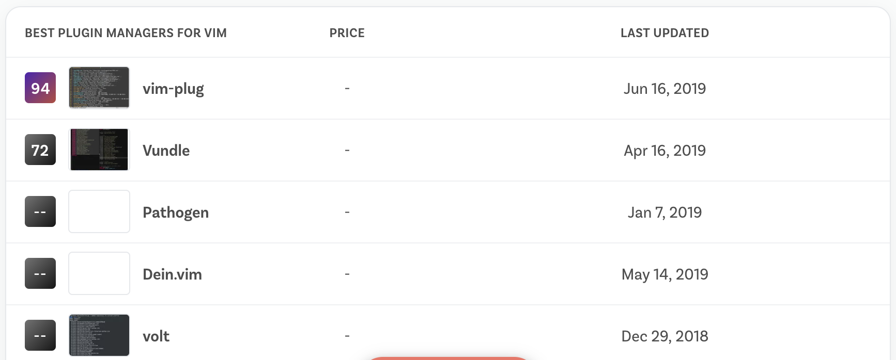
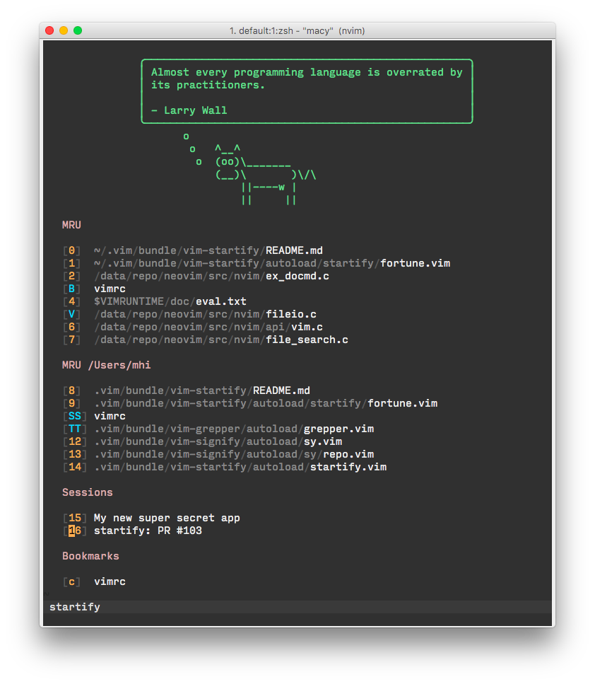
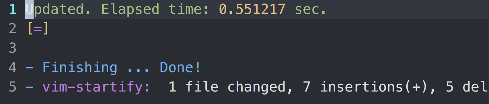

It is Plugin that makes Vim colorful and easy to use. In this post I record my way of learning to use vim plugins managers.


# Which one?

When I search the `vim plugins manager` on google, I found there are many good plugins managers. Here is the rank of ["*The best plugin managers for vim*"](<https://www.slant.co/topics/1224/~best-plugin-managers-for-vim>) on **Slant**



I saw several wonderful vim plugin managers such as `vim-plug`, `Vundle`, `Pathogen`, `Dein.vim` and so on. They both have pros and cons, and after some investigation I finally decide to use `vim-plug`. 

Here are some information about these plugin managers.

* Vim-plug

> Pros: 
>
>  	1. Really light
>  	2. Parallel plugin installation makes it really fast
>  	3. On-demand loading for faster startup time


* Vundle

> Pros:
>
> 1. Easy to use
> 2. Can find, install, update plugins automatically

> Cons:
>
> 1. Old
> 2. Vimrc can get noisy
> 3. Slower if compared to vim-plug


* Pathogen

> Pros:
>
> 1. Minimal additions to .vimrc file
> 2. More control over your plugins

> Cons:
>
> 1. More manual work


* Dein.vim

> Pros:
>
> 1. Fast

>Cons:
>
>1. Complex to set up/ understand
>2. Limited documentation


And here is an [article](<https://junegunn.kr/2014/07/vim-plugins-and-startup-time>) about vim plugins and startup time. The author conclude that 

> By not loading plugins that are not immediately needed, [NeoBundle](https://github.com/Shougo/neobundle.vim) and [vim-plug](https://github.com/junegunn/vim-plug) both managed to reduce the startup times by around 107ms. [vim-plug](https://github.com/junegunn/vim-plug) now takes only 135ms to start.


# Use `vim-plug` to manage plugins

The rest part are summaries for README on [vim-plug github site](<https://github.com/junegunn/vim-plug>).


## Install

In Mac, it is really simple

```sh
$ curl -fLo ~/.vim/autoload/plug.vim --create-dirs \ 

https://raw.githubusercontent.com/junegunn/vim-plug/master/plug.vim
```


This command will download plug.vim and put it in the "$HOME/.vim/autoload" directory.


## Usage Pipeline

The usage is really straightforward and simple. There are basically **three** steps.

1. Write `Plug 'GitHub_postfix_of_the_plugin'` in the `.vimrc` file between the line `call plug#begin('~/.vim/plugged')` and the line `call plug#end()`. For more options, see "Plug options" section.

2. `$ source ~/.vimrc` or in vim run `:source %` to make the `.vimrc` works.

3. In vim, run `:PlugInstall`. It will open a new window and run things like these

   

   


For example, 

I want to install `vim-startify`.

Once you have installed it, when you run `$vim` in your command line, it will show a page looks like this, 

. 

As the github site says:

> It provides **dynamically created headers or footers** and uses configurable lists to show **recently used or bookmarked files** and **persistent sessions**. All of this can be accessed in a **simple to use menu** that even allows to **open multiple entries** at once.

For example, you can just type `0` and vim will open the corresponding file appears in the list. In the picture, it will open `~/.vim/bundle/vim-startify/README.md`.

First go to the [GitHub site of vim stratify](<https://github.com/mhinz/vim-startify>), we can see the URL is `<https://github.com/mhinz/vim-startify>` so copy the postfix of URL "mhinz/vim-startify" to .vimrc file. Now the .vimrc looks like this 

```
" Specify a directory for plugins
" - For Neovim: ~/.local/share/nvim/plugged
" - Avoid using standard Vim directory names like 'plugin'
call plug#begin('~/.vim/plugged')

" vim startify
Plug 'mhinz/vim-startify'

" Initialize plugin system
call plug#end()
```

Then in vim, run `:source %` to make it work.

At last, in vim, run `:PlugInstall` to install the plugin.


## Plug options

There are also some options you can choose when you install the plugins. Just put the options behind the `Plug 'GitHub_postfix_of_the_plugin'` 

For example, for `nerdtree` plugin, you can use on-demanding loading for faster startup time.

```sh
" On-demand loading
Plug 'scrooloose/nerdtree', { 'on':  'NERDTreeToggle' }
```

NERD tree will be loaded on the first invocation of NERDTreeToggle command.

Or the plugin in inside the subdirectory of GitHub repo. You can use `rtp` to specify the subdirectory that contains vim plugin. For example, I want a color scheme and it is a colorscheme for many programs, so to specify the vim plugin, I use

```sh
Plug 'sonph/onehalf', {'rtp': 'vim/'}
```

It means the corresponding vim plugin is in the "vim/" directory.

There are some plugins that require extra steps after installation or update. In that case, use `do` option to describe the task to be performed.

```sh
Plug 'Shougo/vimproc.vim', { 'do': 'make' }
Plug 'Valloric/YouCompleteMe', { 'do': './install.py' }
```

If the value starts with `:`, it will be recognized as a Vim command.

```sh
Plug 'fatih/vim-go', { 'do': ':GoInstallBinaries' }
```


| Option                  | Description                                      |
| ----------------------- | ------------------------------------------------ |
| `branch`/`tag`/`commit` | Branch/tag/commit of the repository to use       |
| `rtp`                   | Subdirectory that contains Vim plugin            |
| `dir`                   | Custom directory for the plugin                  |
| `as`                    | Use different name for the plugin                |
| `do`                    | Post-update hook (string or funcref)             |
| `on`                    | On-demand loading: Commands or `<Plug>`-mappings |
| `for`                   | On-demand loading: File types                    |
| `frozen`                | Do not update unless explicitly specified        |


## Commands

There are some commands for vim-plug, I just copy it from the GitHub site. 

For example, if you want to update `vim-startify`, in vim, type `:PlugUpdate vim-startify`  Then it looks like this




| Command                             | Description                                                  |
| ----------------------------------- | ------------------------------------------------------------ |
| `PlugInstall [name ...] [#threads]` | Install plugins                                              |
| `PlugUpdate [name ...] [#threads]`  | Install or update plugins                                    |
| `PlugClean[!]`                      | Remove unused directories (bang version will clean without prompt) |
| `PlugUpgrade`                       | Upgrade vim-plug itself                                      |
| `PlugStatus`                        | Check the status of plugins                                  |
| `PlugDiff`                          | Examine changes from the previous update and the pending changes |
| `PlugSnapshot[!] [output path]`     | Generate script for restoring the current snapshot of the plugins |