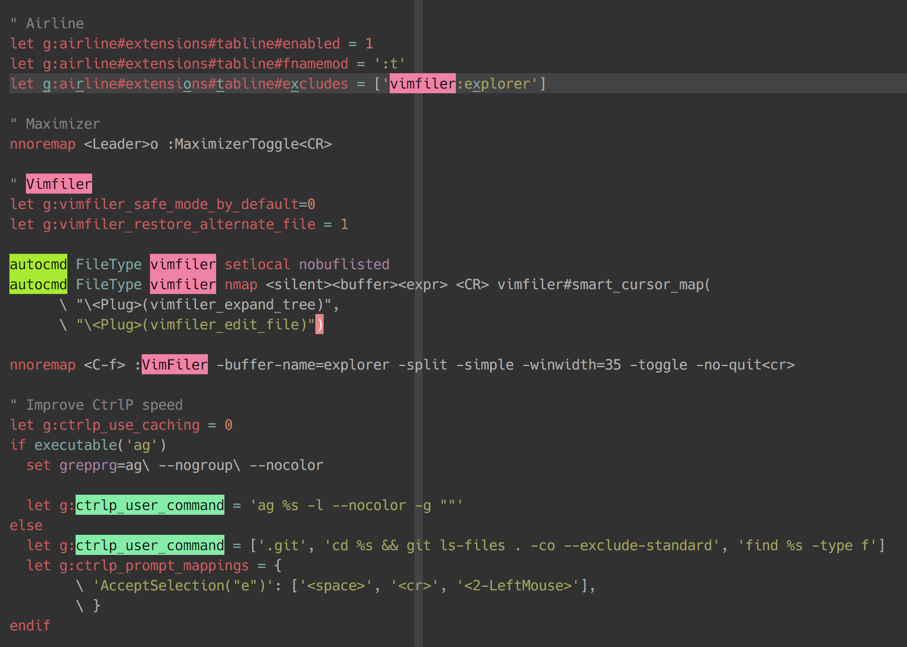
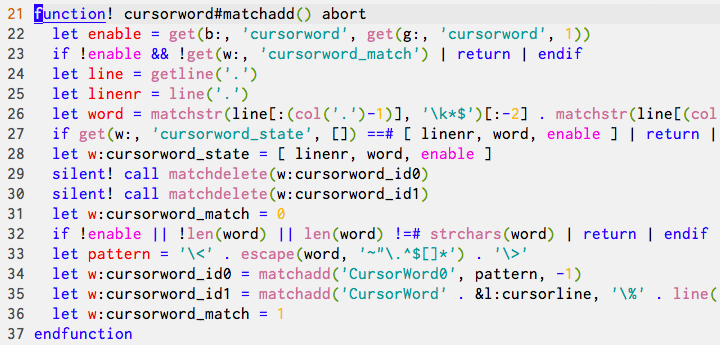

In this post, I would like to share two Plugins that can make your code more conspicuous in vim.


# vim-interestingwords

The first Plugin is `vim-interestingwords`. 

This plugin can highlight the occurrences of the word under the cursor. The beauty of this plugin is it can highlight different words simultaneously with different color. And this feature is really helpful when you navigate the code.

The plugin looks like this:



## Installation 

The installation is simple, I use the `vim-plug` plugin manager to install it.

First add the following line to `.vimrc` file 

```sh
Plug 'lfv89/vim-interestingwords'
```

Then `source .vimrc` in terminal to make rc file work and finally run `:PlugInstall` in vim.


## Usage

* Highlight words

Use `<leader>k`  to highlight all the occurrence of the word under the current cursor, and press it again to cancel the highlighting.

We can highlight multiple different words at the same time with different color.

* Navigating through words

Use `N` and `n` to navigate through the occurrences of this word. This is just like what we do through the results of a search.

* Clear all highlight

Use `<leader>K` to cancel all highlight words.


## Configuration

I think the default config is OK enough for me. However, if we want to personalize our own configuration. It is also welcome. We can add the following config to our `.vimrc` file

* mapping

```sh
nnoremap <silent> short_cut_for_highlight_words :call InterestingWords('n')<cr>
nnoremap <silent> short_cut_for_clear_all_highlight :call UncolorAllWords()<cr>

nnoremap <silent> short_cut_for_navigate_previous_word :call WordNavigation('forward')<cr>
nnoremap <silent> short_cut_for_navigate_next_word :call WordNavigation('backward')<cr>
```


* color

```sh
let g:interestingWordsGUIColors = ['#8CCBEA', '#A4E57E', '#FFDB72', '#FF7272', '#FFB3FF', '#9999FF']
```

If you want to randomize the colors

```sh
let g:interestingWordsRandomiseColors = 1
```


# vim-cursorword

The second plugin is `vim-cursorword`.

This plugin can underlines the word under the cursor and underline the occurrences of this word at the same time.

The plugin looks like this:




## Installation

Again, I use `vim-plug` in install this plugin.

First add the following line to `.vimrc` file 

```sh
Plug 'itchyny/vim-cursorword'
```

Then `source .vimrc` in terminal to make rc file work and finally run `:PlugInstall` in vim.


## Usage

After the installation, the plugin will work immediately and you don't have to do anything.