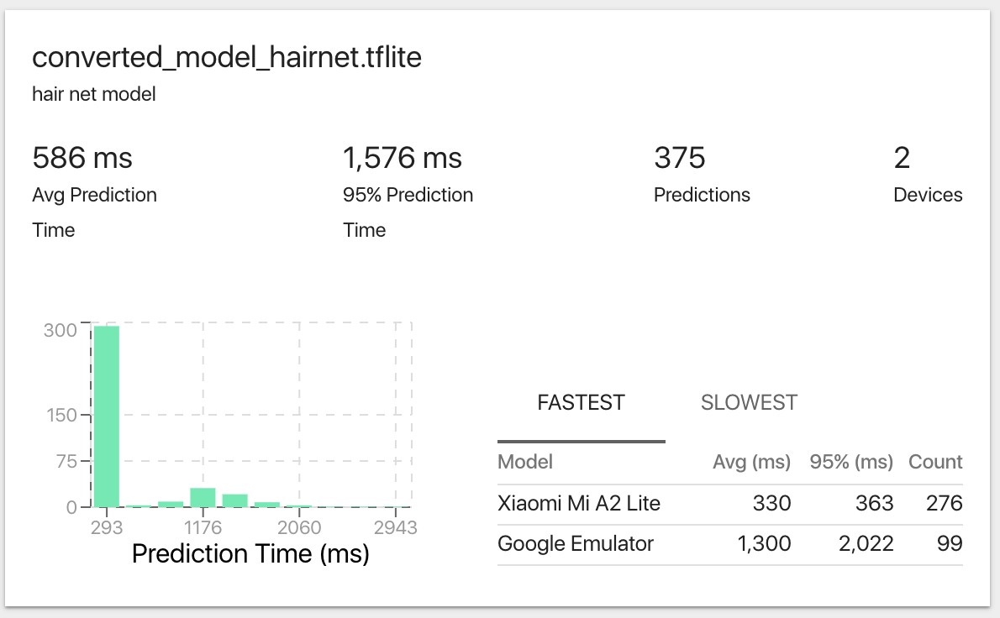

In this post, I would like to share how to deploy tensorflow lite model into android application. This post concentrate more on deployment. For training procedures, refer to [repo](<https://github.com/aobo-y/hair-dye>). And all the android code is available on [repo](<https://github.com/quq99/hair-dye-android>).


# Fritz Androide SDK

Fritz is a platform that allows you to create ML features in your mobile applications with ease. [Fritz repo](<https://github.com/fritzlabs/fritz-repository>)


# Set up Fritz account and initialize the SDK

First we need a Fritz account to upload the model and manage our project. Sign up a Fritz account and create a project. Then add an android application. Follow the instructions:

## Register your app

Follow the instructions provided by Fritz.

## Add the Fritz SDK

Install Fritz Core via Gradle

* In your root-level Gradle file (`build.gradle`), include the Maven repository for Fritz.

```json
allprojects {
    repositories {
        maven { url "https://raw.github.com/fritzlabs/fritz-repository/master" }
    }
}
```


* In your app-level Gradle file (`app/build.gradle`), add the dependency for the core SDK.

```json
dependencies {
    implementation 'ai.fritz:core:3+'
}
```

## Edit your AndroidManifest.xml

* Register the FritzCustomModelService in your AndroidManifest.

  

  ```php+HTML
  <manifest xmlns:android="http://schemas.android.com/apk/res/android">
      <!-- For model performance tracking & analytics -->
      <uses-permission android:name="android.permission.INTERNET" />
  
      <application>
          <!-- Register the custom model service for OTA model updates -->
          <service
              android:name="ai.fritz.core.FritzCustomModelService"
              android:exported="true"
              android:permission="android.permission.BIND_JOB_SERVICE" />
      </application>
  </manifest>
  ```

## Initialize Fritz

* Before managing custom models or using Fritz features, initialize the SDK by calling **Fritz.configure()** with your API Key. This only needs to be done once when the app launches.

  Add the following code into MainActivity class. The API key can be seen on dashboard "Project Settings -> Project Apps -> Actions -> show API key".

  ```java
  public class MainActivity extends AppCompatActivity {
      @Override
      protected void onCreate(Bundle savedInstanceState) {
          // Initialize Fritz
          Fritz.configure(this, "API key");
      }
  }
  ```


# Add the HairNet model

## Upload the tensorflow lite model

In Dashboard, Click "Custom Models" and choose "CREATE NEW MODEL" to upload models. Then click the model and choose "SDK INSTRUCTIONS", we can see some instructions and information of the model

> Model Id: **YOUR MODEL ID HERE**
>
> Model Version: **1**
>
> Model Path: **file:///android_asset/converted_model_hairnet.tflite** (The path to your model in your Android assets folder) 


The instrucitons may be helpful, however, I use a different API for creating predictor. see `Create a Segmentation Predictor with a Hair Segmentation model` part.

When running the program, we can see the model's information in "Custom Models" part.


## Add Fritz’s TFLite Library

In your app-level Gradle file (`app/build.gradle`),

```json
dependencies {
    implementation 'ai.fritz:core:3+'
    implementation "ai.fritz:vision:3+"
    implementation 'ai.fritz:custom-model-tflite:3+'
}
```

This can make you include your own tensorflow lite model into your application.


## No compress model when build the apk

Under the hood, we use [TensorFlow Lite](https://heartbeat.fritz.ai/how-tensorflow-lite-optimizes-neural-networks-for-mobile-machine-learning-e6ffa7f8ee12) as our mobile machine learning framework. In order to make sure that the model isn’t compressed when the APK is built, we’ll need to add the following code in the same build file under the `android` option.

```json
android {
	aaptOptions {
        noCompress "tflite"
        noCompress "lite"
    }
}
```


# Create a Segmentation Predictor with a Hair Segmentation model

We can either include the model with the app or load the model when the app runs (recommended to reduce the size of your APK). In my project, I include my model on device.

## Create model class

In Dashboard, Click "Custom Models" and choose the uploaded model, click it and then click "SDK Instructions". You can see a brief instruction and our model ID. The ID is used for marking the specific model so that he Fritz can monitor the model's performance. Because we include the model on device rather than load the model at running time. I also placed the model on local directory. The model is placed in `/app/src/main/assets/converted_model_hairnet.tflite`.

Also, I found that the instructions provided by Fritz did not work well for me. So, I search the documentation and create my own model class.

If we use the Fritz provided model, 

```java
// Initialize the model included with the app
SegmentOnDeviceModel onDeviceModel = new HairSegmentationOnDeviceModel();
```

This line will initialize a `HairSegmentationOnDeviceModel` class and convert it to `SegmentOnDeviceModel` class. This class will use the pretrained model provided by Fritz. So how can I use my own model?

I searched the API document, and I noticed the inherit structure:

| java.lang.Object                                             |
| ------------------------------------------------------------ |
| ↳[ai.fritz.core.FritzManagedModel](https://docs.fritz.ai/android/3.8.2/reference/ai/fritz/core/FritzManagedModel.html) |
| ↳[ai.fritz.core.FritzOnDeviceModel](https://docs.fritz.ai/android/3.8.2/reference/ai/fritz/core/FritzOnDeviceModel.html) |
| ↳[ai.fritz.vision.imagesegmentation.SegmentOnDeviceModel](https://docs.fritz.ai/android/3.8.2/reference/ai/fritz/vision/imagesegmentation/SegmentOnDeviceModel.html) |
| ↳ai.fritz.fritzvisionhairsegmentationmodel.HairSegmentationOnDeviceModel |

So I can mimic the `HairSegmentationOnDeviceModel` and create an new class inherent from `ai.fritz.vision.imagesegmentation.SegmentOnDeviceModel`. 

The next thing is, I should tell the constructor the information about my model including input/output layer name, and input/output size. 

I found that the constructor of `SegmentOndeviceModel` looks like this.

```java
SegmentOnDeviceModel(String modelPath, String modelId, int modelVersion, MaskType[] classifications, String inputLayerName, int inputSize, String outputLayerName, int outputSize)
```

So, my model class looks like this:

The input layer name is "input:0" and the output name is "Sigmoid:0". The image size is 224 * 224. the output size is the same.

```java
package com.Qian.HairDye;

import ai.fritz.vision.imagesegmentation.MaskType;
import ai.fritz.vision.imagesegmentation.SegmentOnDeviceModel;

public class Train_170CustomModel extends SegmentOnDeviceModel {

    private static final String MODEL_PATH = "file:///android_asset/converted_model_hairnet.tflite";
    private static final String MODEL_ID = "9c021ee48c3c4d668b1f8a1a01198a71";
    private static final int MODEL_VERSION = 1;
    private static MaskType[] hair = { MaskType.HAIR };

    public Train_170CustomModel() {
        super(MODEL_PATH, MODEL_ID, MODEL_VERSION, hair, "input:0", 224, "Sigmoid:0", 224);
    }
}
```


##  Set up a predictor using own model

In setupPredictor() method in MainActivity class, write these two lines:

```java
SegmentOnDeviceModel onDeviceModel = new Train_170CustomModel();
predictor = FritzVision.ImageSegmentation.getPredictor(onDeviceModel);

```

In this two lines code, we first initialize a new model and then call the `getPredictor` function to get a predictor class. the `getPredictor` function looks like this.

```java
public FritzVisionSegmentPredictor getPredictor (SegmentOnDeviceModel onDeviceModel, FritzVisionSegmentPredictorOptions options)
```


so by calling this function, we will get a `FritzVisionSegmentPredictor` object. The input parameter is our model object. 

The next question is what does this  `FritzVisionSegmentPredictor` class(the `predict`) do? I look at the class definition:

```java
package ai.fritz.vision.imagesegmentation;

/**
 * The predictor for image segmentation models.
 */
public class FritzVisionSegmentPredictor extends FritzVisionSegmentTFLPredictor {

    public FritzVisionSegmentPredictor(SegmentOnDeviceModel segmentOnDeviceModel, FritzVisionSegmentPredictorOptions options) {
        super(segmentOnDeviceModel, options);
    }
}

```

It extends from `FritzVisionSegmentTFLPredictor`, so go one step to look at this class.

```java
package ai.fritz.vision.imagesegmentation;

import android.graphics.Bitmap;
import android.util.Log;
import android.util.Size;

import java.nio.ByteBuffer;
import java.nio.ByteOrder;
import java.util.List;

import ai.fritz.core.constants.ModelEventName;
import ai.fritz.core.utils.EventTracker;
import ai.fritz.vision.FritzVisionImage;
import ai.fritz.vision.base.FritzVisionTFLitePredictor;
import ai.fritz.vision.base.PreparedImage;

/**
 * The predictor class for image segmentation with the TFL backend.
 *
 * @deprecated Please use {@link FritzVisionSegmentPredictor}. This class will be removed in the next major version update.
 */
public class FritzVisionSegmentTFLPredictor extends FritzVisionTFLitePredictor<FritzVisionSegmentResult> {

    private static final String TAG = FritzVisionSegmentTFLPredictor.class.getSimpleName();

    private static final int NUM_CHANNELS = 3;

    private int inputSize;
    private int outputSize;

    private int[] intValues;
    private MaskType[] segmentClassifications;
    private FritzVisionSegmentPredictorOptions options;

    private ByteBuffer inputByteBuffer;
    private ByteBuffer outputByteBuffer;

    public FritzVisionSegmentTFLPredictor(SegmentOnDeviceModel segmentOnDeviceModel, FritzVisionSegmentPredictorOptions options) {
        super(segmentOnDeviceModel);
        initializeValues(segmentOnDeviceModel, options);
    }

    private void initializeValues(SegmentOnDeviceModel segmentOnDeviceModel, FritzVisionSegmentPredictorOptions options) {
        this.inputSize = segmentOnDeviceModel.getInputSize();
        this.outputSize = segmentOnDeviceModel.getOutputSize();
        interpreter.setNumThreads(options.getNumThreads());
        this.segmentClassifications = setTargetClassifications(segmentOnDeviceModel.getClassifications(), options.getTargetSegments());

        inputByteBuffer = ByteBuffer.allocateDirect(4 * inputSize * inputSize * NUM_CHANNELS);
        inputByteBuffer.order(ByteOrder.nativeOrder());

        outputByteBuffer = ByteBuffer.allocateDirect(4 * outputSize * outputSize * segmentClassifications.length);
        outputByteBuffer.order(ByteOrder.nativeOrder());

        this.intValues = new int[inputSize * inputSize];
        this.options = options;
    }

    public void setOptions(FritzVisionSegmentPredictorOptions options) {
        this.options = options;
        this.segmentClassifications = setTargetClassifications(this.segmentClassifications, options.getTargetSegments());
        interpreter.setNumThreads(options.getNumThreads());
    }

    /**
     * Identify and create pixel-level masks for all items in visionImage.
     *
     * @param visionImage
     * @return FritzVisionSegmentResult
     */
    @Override
    public FritzVisionSegmentResult predict(FritzVisionImage visionImage) {
        long start = System.nanoTime();
        Size modelInputSize = new Size(inputSize, inputSize);
        PreparedImage preparedImage = PreparedImage.create(visionImage, options.getCropAndScaleOption(), modelInputSize);

        preprocess(preparedImage.getBitmapForModel());
        long preprocessTiming = System.nanoTime() - start;
        EventTracker.getInstance().trackCustomTiming(ModelEventName.MODEL_PREPROCESS, onDeviceModel, preprocessTiming);

        outputByteBuffer.rewind();
        start = System.nanoTime();
        interpreter.run(inputByteBuffer, outputByteBuffer);
        Log.d(TAG, "model inference took " + Math.floor((System.nanoTime() - start) / 1e6) + "ms to run.");

        start = System.nanoTime();
        FritzVisionSegmentResult result = postprocess(visionImage, preparedImage);
        long postprocessTiming = System.nanoTime() - start;
        EventTracker.getInstance().trackCustomTiming(ModelEventName.MODEL_POSTPROCESS, onDeviceModel, postprocessTiming);

        return result;
    }

    private MaskType[] setTargetClassifications(MaskType[] classifications, List<MaskType> targetSegments) {
        // if no target segments set, then use the default
        if (targetSegments == null) {
            return classifications;
        }

        // Filter out the classes outside of the target segments
        for (int i = 0; i < classifications.length; i++) {
            MaskType maskType = classifications[i];
            if (!targetSegments.contains(maskType)) {
                classifications[i] = MaskType.NONE;
            }
        }

        return classifications;
    }

    private void preprocess(Bitmap bitmap) {
        bitmap.getPixels(intValues, 0, bitmap.getWidth(), 0, 0, bitmap.getWidth(), bitmap.getHeight());
        inputByteBuffer.rewind();
        for (int row = 0; row < inputSize; row++) {
            for (int col = 0; col < inputSize; col++) {
                int pixel = intValues[row * inputSize + col];

                float blue = (float) (pixel & 0xFF) / 255f - 0.5f;
                float green = (float) ((pixel >> 8) & 0xFF) / 255f - 0.5f;
                float red = (float) ((pixel >> 16) & 0xFF) / 255f - 0.5f;

                inputByteBuffer.putFloat(red);
                inputByteBuffer.putFloat(green);
                inputByteBuffer.putFloat(blue);
            }
        }
    }

    private FritzVisionSegmentResult postprocess(FritzVisionImage visionImage, PreparedImage preparedImage) {
        int[][] classifications = new int[outputSize][outputSize];
        float[][] confidence = new float[outputSize][outputSize];

        for (int row = 0; row < outputSize; row++) {
            int rowOffset = row * outputSize * segmentClassifications.length;

            for (int col = 0; col < outputSize; col++) {
                int maxClassProbIndex = 0;
                float maxClassProbValue = 0;

                int colOffset = col * segmentClassifications.length;
                int offset = rowOffset + colOffset;

                for (int classIndex = 0; classIndex < segmentClassifications.length; classIndex++) {
                    float classProb = outputByteBuffer.getFloat((offset + classIndex) * 4);

                    // Arg max
                    if (classProb > maxClassProbValue) {
                        maxClassProbIndex = classIndex;
                        maxClassProbValue = classProb;
                    }
                }

                classifications[row][col] = maxClassProbIndex;
                confidence[row][col] = maxClassProbValue;
            }
        }

        return new FritzVisionSegmentResult(
                visionImage, preparedImage,
                options, segmentClassifications,
                preparedImage.getTargetInferenceSize(),
                new Size(outputSize, outputSize),
                preparedImage.getOffsetX(),
                preparedImage.getOffsetY(),
                classifications, confidence);
    }
}
```

Now I just concentrate on the constructor which is `initializeValues` function.

```java
private void initializeValues(SegmentOnDeviceModel segmentOnDeviceModel, FritzVisionSegmentPredictorOptions options) {
        this.inputSize = segmentOnDeviceModel.getInputSize();
        this.outputSize = segmentOnDeviceModel.getOutputSize();
        interpreter.setNumThreads(options.getNumThreads());
        this.segmentClassifications = setTargetClassifications(segmentOnDeviceModel.getClassifications(), options.getTargetSegments());

        inputByteBuffer = ByteBuffer.allocateDirect(4 * inputSize * inputSize * NUM_CHANNELS);
        inputByteBuffer.order(ByteOrder.nativeOrder());

        outputByteBuffer = ByteBuffer.allocateDirect(4 * outputSize * outputSize * segmentClassifications.length);
        outputByteBuffer.order(ByteOrder.nativeOrder());

        this.intValues = new int[inputSize * inputSize];
        this.options = options;
    }
```

We can see it just initialize the necessary information about the model. The `segmentClassifications` is a `MaskType[]` variable which tells the predictor what type of segmentation you want. In my project it is just `MaskType.HAIR`  and is given by my defined class  `Train_170CustomModel`. The default batch size is 4 and the input image has same height and width size.


> The rest part is pretty much the same like the fritz [tutorial](<https://heartbeat.fritz.ai/embrace-your-new-look-with-hair-segmentation-by-fritz-now-available-for-android-developers-f20f5b4e9ae1>), I follow the same structures and add some notes.

# Choose a hair color for prediction

So our model will predict a hair mask, and use the hair mask overlay to blend the color with the original image. Now it will color the hair to BLUE.

```java
MaskType.HAIR.color = Color.BLUE;
```

| java.lang.Object |                                            |
| ---------------- | ------------------------------------------ |
| ↳                | ai.fritz.vision.imagesegmentation.MaskType |

`MaskType` tells what kind of mask we want to use. It includes several types of masks such as BED, HAIR, FLOOR, PERSON. Also it has a public method `setColor(int color)` which set the color you'd like for this mask type.

# Run prediction on an image to detect hair

Images can come from a camera, a photo roll, or live video. In this project I catch the images from the camera. 

In the code below, we convert an `android.media.Image` object (`YUV_420_888`format*)* into a `FritzVisionImage` object to prepare it for prediction. This is usually the case when reading from a live camera capture session.

```java
// Determine how to rotate the image from the camera used.
int rotation = FritzVisionOrientation.getImageRotationFromCamera(this, cameraId);

// Create a FritzVisionImage object from android.media.Image
FritzVisionImage visionImage = FritzVisionImage.fromMediaImage(image, rotation);
```

We may also convert a `Bitmap` to a `FritzVisionImage`

```
FritzVisionImage visionImage = FritzVisionImage.fromBitmap(bitmap);
```

After we’ve create a `FritzVisionImage` object, call `predictor.predict`.

```java
// Run the image through the model to identify pixels representing hair.
FritzVisionSegmentResult segmentResult = predictor.predict(visionImage);
```

This will return a `segmentResult` that we can use to display the hair mask.  

We can look at the `FritzVisionSegmentTFLPredictor` to see what happened when calling the predict function:

```java
public FritzVisionSegmentResult predict(FritzVisionImage visionImage) {
        long start = System.nanoTime();
        Size modelInputSize = new Size(inputSize, inputSize);
        PreparedImage preparedImage = PreparedImage.create(visionImage, options.getCropAndScaleOption(), modelInputSize);

        preprocess(preparedImage.getBitmapForModel());
        long preprocessTiming = System.nanoTime() - start;
        EventTracker.getInstance().trackCustomTiming(ModelEventName.MODEL_PREPROCESS, onDeviceModel, preprocessTiming);

        outputByteBuffer.rewind();
        start = System.nanoTime();
        interpreter.run(inputByteBuffer, outputByteBuffer);
        Log.d(TAG, "model inference took " + Math.floor((System.nanoTime() - start) / 1e6) + "ms to run.");

        start = System.nanoTime();
        FritzVisionSegmentResult result = postprocess(visionImage, preparedImage);
        long postprocessTiming = System.nanoTime() - start;
        EventTracker.getInstance().trackCustomTiming(ModelEventName.MODEL_POSTPROCESS, onDeviceModel, postprocessTiming);

        return result;
    }
```

Basically, it does three things, `preprocessing`, `interpreter.run` and `post processing`. The core thing is `interpreter.run`. 

First, the `interpreter` is defined in another class

```java
package ai.fritz.vision.base;

import org.tensorflow.lite.Interpreter;

import ai.fritz.core.FritzOnDeviceModel;
import ai.fritz.customtflite.FritzTFLiteInterpreter;
import ai.fritz.vision.FritzVisionImage;

/**
 * TFL Predictor
 * @hide
 */
public abstract class FritzVisionTFLitePredictor<T> extends FritzVisionPredictorBase {


    protected FritzOnDeviceModel onDeviceModel;
    protected FritzTFLiteInterpreter interpreter;


    public FritzVisionTFLitePredictor(FritzOnDeviceModel onDeviceModel) {
        this(onDeviceModel, new Interpreter.Options());
    }

    public FritzVisionTFLitePredictor(FritzOnDeviceModel onDeviceModel, Interpreter.Options interpreterOptions) {
        this.onDeviceModel = onDeviceModel;
        this.interpreter = new FritzTFLiteInterpreter(onDeviceModel, interpreterOptions);
    }

    public void close() {
        this.interpreter.close();
    }
}
```

As the code shows, `interpreter` is an `ai.fritz.customtflite.FritzTFLiteInterpreter` class instance which is defined by ourself. We pass our model through `onDeviceModel` and get an interpreter instance.

Then we call the `interpreter.run` function to get the prediction. We look into the `ai.fritz.customtflite.FritzTFLiteInterpreter` class and see the `run` function

```java
/**
     * Run model inference on the input and output methods.
     * <p>
     * The interpreter will record metrics on model execution.
     */
    public void run(Object input, Object output) {
        modelDownloadManager.checkForNewActiveVersion();
        this.interpreter.run(input, output);
        trackInferenceTime();
    }
```

We can see it calls the `this.interpreter.run` function. So where is the interpreter? we can see in the `FritzTFLiteInterpreter` class, the interpreter is just a tensorflow lite Interpreter class. So that's it. Fritz framework finally calls the tensorflow lite `interpreter.run` function to run the model and get the prediction. 

```java
// sample lines in FritzTFLiteInterpreter class
import org.tensorflow.lite.Interpreter;
private Interpreter interpreter;
```


# Blend the mask onto the original image

Now that we have the result from the model, let’s extract the mask and blend it with the pixels on the original image.

First, pick one of 3 different blend modes:

```java
// Soft Light Blend
BlendMode blendMode = BlendModeType.SOFT_LIGHT.create();

// Color Blend
BlendMode blendMode = BlendModeType.COLOR.create();

// Hue Blend
BlendMode blendMode = BlendModeType.HUE.create();
```

I choose HUE blend model.

Next, extract the mask for which we detected hair in the image. The Segmentation Predictor has a method called `createMaskOverlayBitmap` that returns a colored`Bitmap` of the classified pixels. In this case, red indicates detected hair. 

```java
Create a bitmap of the overlay to apply to an image.
* This will have the model output dimensions.
* <p>
* Default alpha value is 60.
*
* @return a bitmap of the overlay
public Bitmap createMaskOverlayBitmap() {
        return buildMultiClassMask();
    }
```

```java
Bitmap maskBitmap = segmentResult.createMaskOverlayBitmap(blendMode.getAlpha());
```

Finally, let’s blend `maskBitmap` with the original image.

```java
// Get the original image.
FritzVisionImage visionImage = segmentResult.getOriginalImage();

// Blend the original image with the mask and the blend mode.
Bitmap blendedBitmap = visionImage.blend(maskBitmap, blendMode);
```


# Track the performance of your model

I deployed the model to android applicaiton and run it on "Xiaomi Mi A2 Lite" mobile phone. Look at the prediction time on the "Custom Models" board, we can see that the average prediction time is 330ms which is acceptable. And 95% of the prediction time is under 363 ms indicating that our model is pretty stable.

