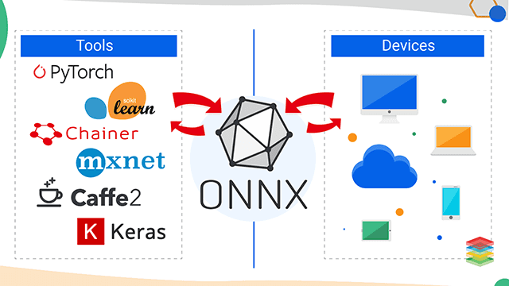
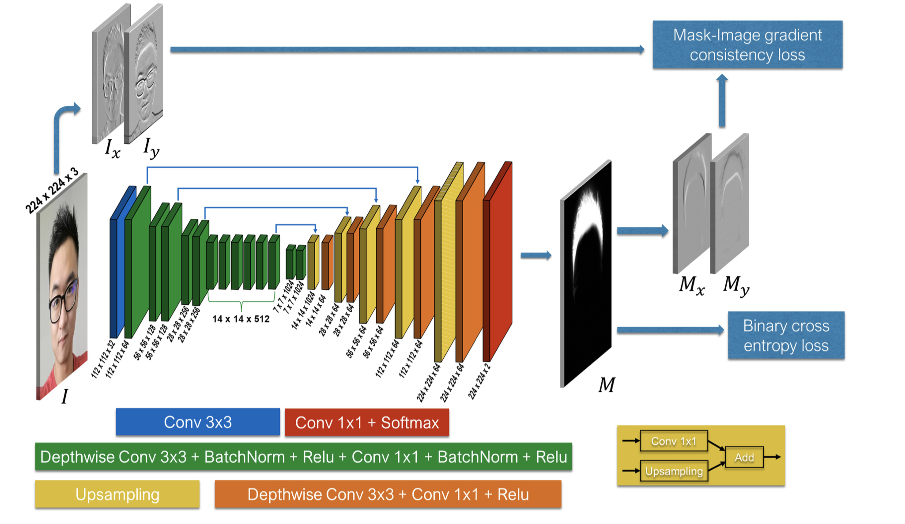
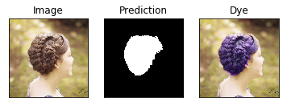

In this post, I would like to share how to convert a trained Pytorch model to a Tensorflow model.


# ONNX

What is ONNX?

[ONNX(Open Neural Network Exchange)](<https://github.com/onnx/onnx>) is an open ecosystem that empowers AI developers to choose the right tools as their project evolves. Briefly speaking, it enables interoperability between different frameworks and streamlining the path from research to production helps increase the speed of innovation in the AI community. To achieves this, it defines an extensible computation graph model, as well as built in operators and standard data types.




We can think the Deep Learning as calculation over data flow graphs. The graphs are divided into two types: `Dynamic` and `Static` graphs. Different deep learning framework uses different kind of graphs. For instance, frameworks like Tensorflow, Caffe2, CNTK, Theano prefer to use static graph while others such as Pytorch, Chainer use dynamic graphs. 

Both of them have Pros and Cons. As for static graph, once the graph is defined it can be used multiple times as fast as possible cause we are not going to create anything new. Also, the static computation graph can be used to schedule computation across a pool of computational devices so computational cost could be shared. So, once defined we can use the optimization compiler to optimize the graph so that large graph can be run efficiently on either CPUs or GPUs. However, it is not flexible. And, because many logic errors will wait to be uncovered until execution, static graph has difficulty in debugging. As for dynamic graph, it is more flaxible, you can define, change and execute the network as you go. There is no such special `sessions` like we do in static graphs. It is more pythonic and easy to debug. However it is not that fast compared to static graph. So, it will be really great if we could develop the model using dynamic graph and deploy it using static graph. And, here he comes -- ONNX. 

In the rest of this blog, I will use an example to illustrate how to convert a pytorch model to a tensorflow model. The whole .ipynb notebook can be found in our [repository](<https://github.com/aobo-y/hair-dye/blob/master/src/torch2tf.ipynb>)

# Install ONNX

It is easy,

```sh
$ pip install tensorflow onnx onnx-tf
```

 

# Import pytorch model

Our model looks like this, it is proposed by [Alex L. Cheng C, etc. 'Real-time deep hair matting on mobile devices'](https://arxiv.org/pdf/1712.07168.pdf) .




For the pytorch implementation of this model, you can refer to [our repository](<https://github.com/aobo-y/hair-dye/tree/master/src/models>) 


# load torch model and export it to ONNX model

First, define a function to load the model from pertained file.

```python
# import our Hair network
from models import MobileHairNet
# import config file
import config

def build_model(path, device):
    model = MobileHairNet()
    checkpoint = torch.load(path, map_location=device)
    model.load_state_dict(checkpoint['model'])
    # use appropriate device
    model = model.to(device)
    
    return model
```

Then we can load the model. `TORCH_MODEL_PATH` is our pretrained model's path

`hair-dye/src/checkpoints/default/train_170.pt`

Note that to export the model to ONNX model, we need a dummy input, so we just use an random input(batch_size, channel_size, height_size, weight_size). Our model has input size of (1, 3, 224, 224).

After we run the code, the notebook will print some information about the network. It looks like this:


```python
torch_model = build_model(TORCH_MODEL_PATH, device)
# export model to ONNX
# ONNX need a dummy input
dummy_input = Variable(torch.randn(1, 3, config.IMG_SIZE, config.IMG_SIZE))
# pred = torch_model(dummy_input)
# print("output size: ", pred.size())

input_names = ["input"]
output_names = ["output"]
torch.onnx.export(torch_model, dummy_input, ONNX_MODEL_PATH, verbose=True, input_names=input_names, output_names=output_names)
```


> ...
> %215 : Float(1, 32, 224, 224) = onnx::Conv[dilations=[1, 1], group=1, kernel_shape=[3, 3], pads=[1, 1, 1, 1], strides=[2, 2]](%input, %1, %2), scope: MobileHairNet/_EncodeBlockBlueGreen[encode_block1]/Sequential[layer]/_BlueBlock[0]/Conv2d[layer]
>   %216 : Float(1, 32, 224, 224) = onnx::Conv[dilations=[1, 1], group=32, kernel_shape=[3, 3], pads=[1, 1, 1, 1], strides=[1, 1]](%215, %3, %4), scope: MobileHairNet/_EncodeBlockBlueGreen[encode_block1]/Sequential[layer]/_GreenBlock[1]/Sequential[layer]/Conv2d[0]
>   %217 : Float(1, 32, 224, 224) = onnx::BatchNormalization[epsilon=1e-05, is_test=1, momentum=1](%216, %5, %6, %7, %8), scope: MobileHairNet/_EncodeBlockBlueGreen[encode_block1]/Sequential[layer]/_GreenBlock[1]/Sequential[layer]/BatchNorm2d[1]
>   %218 : Float(1, 32, 224, 224) = onnx::Clip[max=6, min=0](%217), scope: MobileHairNet/_EncodeBlockBlueGreen[encode_block1]/Sequential[layer]/_GreenBlock[1]/Sequential[layer]/ReLU6[2]
>   ...


we can check if the network is converted right.

 

# import the ONNX model to tensorflow


```python
# load the onnx file
onnx_model = onnx.load(ONNX_MODEL_PATH)
# Check the model
onnx.checker.check_model(onnx_model)
# print('The model before conversion:\n{}'.format(onnx_or_model))

# # A full list of supported adapters can be found here:
# # https://github.com/onnx/onnx/blob/master/onnx/version_converter.py#L21
# # Apply the version conversion on the original model
# onnx_model = version_converter.convert_version(onnx_or_model, 7)

# print('The model after conversion:\n{}'.format(onnx_model))


# import onnx to TF model
tf_rep = prepare(onnx_model)
```

Here I get an error, 

`NotImplementedError: Upsample version 1 is not implemented.`

I search the Issues on ONNX repo on GitHub. Here is someone's answer

> Upsample was an experimental op in ONNX before opset=7. Since ONNX decided to totally remove experimental ops, we have not taken the implementation for the experimental upsample (opset=1) into the v1.3.0 release. Your onnx file seems for opset=6 therefore the error. If you could possibly regenerate the onnx file with opset 7 or newer, it should work with onnx-tf v1.3.0. Sorry about the confusion.


So, I search the version_converter function in ONNX. Unfortunately it does not work. Then I was considering downgrade the version of ONNX. I search the doc on github repo. I get the version information

| ONNX version | File format version | Operator set version ai.onnx | Operator set version ai.onnx.ml |
| ------------ | ------------------- | ---------------------------- | ------------------------------- |
| 1.0          | 3                   | 1                            | 1                               |
| 1.1          | 3                   | 5                            | 1                               |
| 1.1.2        | 3                   | 6                            | 1                               |
| 1.2          | 3                   | 7                            | 1                               |
| 1.3          | 3                   | 8                            | 1                               |
| 1.4.1        | 4                   | 9                            | 1                               |
| 1.5.0        | 5                   | 10                           | 1                               |

Also I search the operator set support of upsampling

> **Upsample** (deprecated)
>
> Upsample the input tensor. Each dimension value of the output tensor is: output_dimension = floor(input_dimension * scale).
>
> **Version**
>
> This version of the operator has been deprecated since version 10 of the default ONNX operator set.
>
> Other versions of this operator: [Upsample-7](https://github.com/onnx/onnx/blob/master/docs/Changelog.md#Upsample-7), [Upsample-9](https://github.com/onnx/onnx/blob/master/docs/Changelog.md#Upsample-9)


So, it seems I need version 7 operator set. So I need to downgrade the version to 1.2.

```sh
pip install tensorflow==1.13.1 onnx==1.2.1 onnx-tf==1.1.2
```

After some attempt, this version works fine to me.


# Save to file

```python
tf_rep.export_graph(TF_MODEL_PATH)
```

TF_MODEL_PATH is the new tensorflow graph model path

So far, I have finished the work. The rest part is optional

# Run the ONNX model to see if it works（optional）

`ImgTransformer` will load the image and do preprocessing.

```python
class ImgTransformer():
    def __init__(self, img_size, color_aug=False):
        self.img_size = img_size
        self.color_aug = color_aug

    def transform(self, image):
        transformer = transforms.Compose([
            transforms.CenterCrop(min(image.size[0], image.size[1])),
            transforms.Resize(self.img_size)
        ] + ([
            transforms.ColorJitter(brightness=1, contrast=1, saturation=1, hue=.5),
            transforms.RandomGrayscale(p=0.1)
        ] if self.color_aug else []) + [
            transforms.ToTensor(),
            transforms.Normalize((.5, .5, .5), (.5, .5, .5))
        ])

        transform_image = transformer(image)

        return transform_image

    def load(self, path):
        image = Image.open(path).convert('RGB')
        return self.transform(image)
```


```python
img_path = os.path.join(DIR_PATH, config.TEST_CORPUS, "images", "Frame\ \(150\).jpg")
transformer = ImgTransformer(config.IMG_SIZE, color_aug=False)
img =  transformer.load(img_path)
display(img)
```


> tensor([[[ 0.4902,  0.5137,  0.5216,  ..., -0.6471, -0.6471, -0.6471],
>          [ 0.4980,  0.5137,  0.5216,  ..., -0.6471, -0.6471, -0.6471],
>          [ 0.5059,  0.5216,  0.5373,  ..., -0.6471, -0.6471, -0.6392],
>          ...,
>          [ 0.0118, -0.0039,  0.0118,  ...,  0.1529,  0.1373,  0.1137],
>          [-0.0039,  0.0118,  0.0196,  ...,  0.1216,  0.0980,  0.0667],
>          [-0.0118,  0.0118,  0.0196,  ...,  0.0980,  0.0667,  0.0353]],
>
> ​	[[ 0.3569,  0.3804,  0.3882,  ..., -0.7882, -0.7882, -0.7882],
> ​     	[ 0.3647,  0.3804,  0.3882,  ..., -0.7882, -0.7882, -0.7882],
> ​     	[ 0.3647,  0.3804,  0.3961,  ..., -0.7882, -0.7882, -0.7804],
> ​     	...,
> ​     	[-0.1529, -0.1686, -0.1529,  ..., -0.0196, -0.0353, -0.0510],
> ​     	[-0.1451, -0.1294, -0.1137,  ..., -0.0667, -0.0824, -0.0902],
> ​     	[-0.1451, -0.1216, -0.1059,  ..., -0.1059, -0.1137, -0.1216]],
>
> ​	[[-0.2706, -0.2471, -0.2471,  ..., -0.7882, -0.7882, -0.7882],
>  	[-0.2627, -0.2471, -0.2471,  ..., -0.7882, -0.7882, -0.7882],
>  	[-0.2627, -0.2549, -0.2471,  ..., -0.7882, -0.7882, -0.7882],
>  	...,
>  	[-0.4902, -0.5059, -0.4980,  ..., -0.3255, -0.3569, -0.4118],
>  	[-0.5059, -0.4902, -0.4824,  ..., -0.3725, -0.4039, -0.4275],
>  	[-0.5059, -0.4824, -0.4824,  ..., -0.4039, -0.4353, -0.4510]]])


To display the Image, mask, prediction in one row

```python
def create_multi_figure(rows, dye=False):
    fig = plt.figure()

  # 3 tensors, the middle one is mask
    if len(rows[0]) == 3:
        names = ["Image", "Mask", "Prediction"]
    else:
        names = ["Image", "Prediction"]

    for i, data in enumerate(rows):
        img = data[0]
        prediction = data[-1]

        # reverse normalization of the oriignal image
        img = (img + 1) / 2
        data[0] = img

        if dye:
            transform_hue = transforms.Compose([
            transforms.ToPILImage(),
            transforms.ColorJitter(
                hue=0.5, saturation=0.8, contrast=0.2, brightness=0.3),
            transforms.ToTensor()
          ])
            dyed = transform_hue(img)

            dyed = prediction * dyed + (1 - prediction) * img
            data.append(dyed)
            names.append('Dye')


        for j, d in enumerate(data):
            d = d.squeeze()
            im = d.data.numpy()

            if im.shape[0] != 3:
                im = np.expand_dims(im, axis=0)
                im = np.concatenate((im, im, im), axis=0)

            im = im.transpose(1, 2, 0)

            f = fig.add_subplot(len(rows), len(data), i * len(data)+ j + 1)
            f.imshow(im)
            if i == 0:
                f.set_title(names[j])
                f.set_xticks([])
                f.set_yticks([])

    return fig
```


```python
def evaluateOne(img, model, absolute=True):
    img = img.to(device).unsqueeze(0)
    pred = model.run(img)[0]
    pred = torch.from_numpy(pred)
    if absolute:
        pred[pred > .5] = 1.
        pred[pred <= .5] = 0.
    else:
        pred[pred < .4] = 0

    rows = [[img[0], pred[0]]]
    create_multi_figure(rows, dye=True)
    plt.show()
```


```
evaluateOne(img, tf_rep)
```

The results are shown here:

